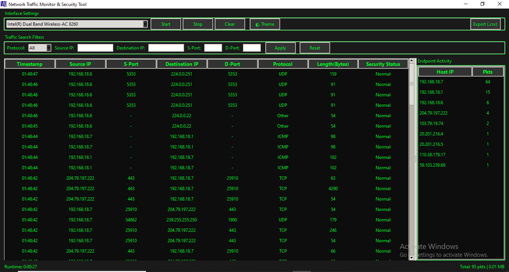
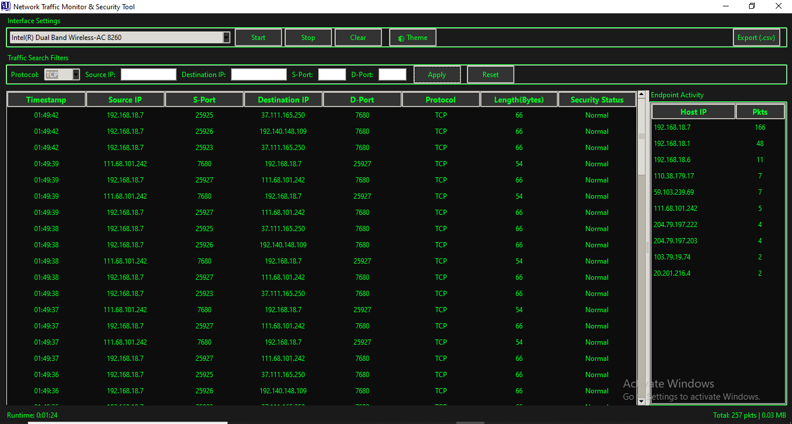
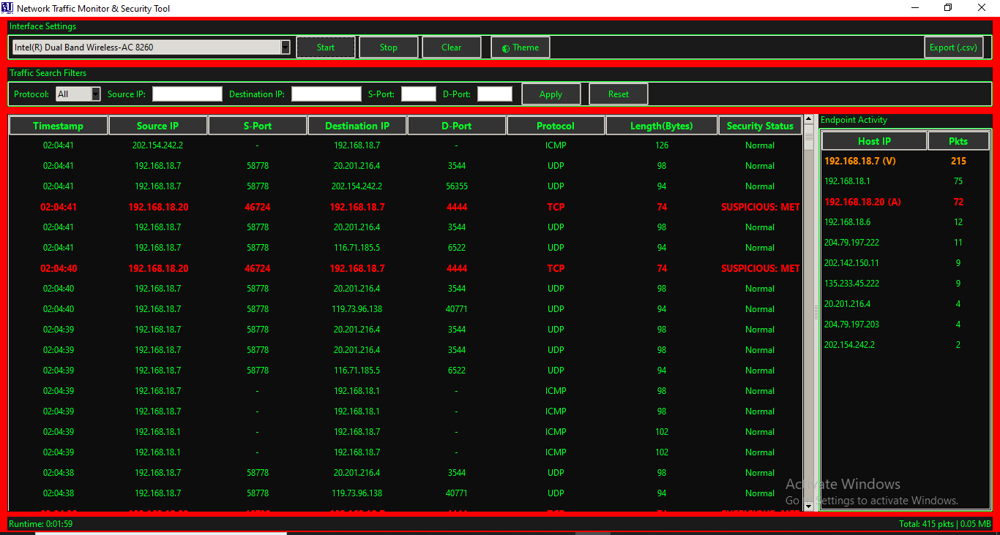
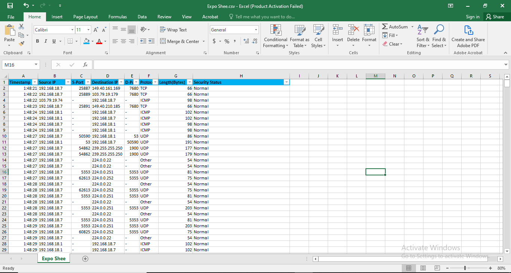

# Network Packet Sniffer

A beginner-friendly network packet capture and analysis tool built with **Python, Scapy, and Tkinter** for real-time traffic inspection and basic security monitoring.

## 🔎 Project Overview

The Network Packet Sniffer captures live network traffic and presents packet information through a graphical interface.

The project was developed to make packet analysis more accessible while demonstrating fundamental concepts in network monitoring, traffic analysis, and security detection.

## ✨ Features

- Real-time packet capture
- TCP, UDP, and ICMP traffic identification
- IP, port, and protocol filtering
- Keyword-based packet searching
- Signature-based security alerts
- CSV packet export
- Pause, clear, start, and stop controls
- Graphical packet inspection interface

## 🛡️ Security Monitoring

The application includes basic signature-based detection capabilities for identifying potentially suspicious network activity, including:

- ICMP flood patterns
- Abnormal TCP SYN activity
- Suspicious HTTP keywords
- Unusual DNS activity

## 🧰 Technologies

- Python
- Scapy
- Tkinter
- Npcap
- TCP/IP
- CSV

  
## 🏗️ Application Workflow

The application follows a four-stage workflow:

1. **Capture:** Capture live network packets through the selected network interface using Scapy.
2. **Analyze:** Extract packet information, including source IP, destination IP, protocol, and ports.
3. **Detect:** Apply basic signature-based rules to identify potentially suspicious network activity.
4. **Export:** Export captured packet information into CSV format for further analysis.

### Processing Pipeline

Network Interface → Packet Capture → Packet Analysis → Security Detection → CSV Export


## 📂 Repository Structure

```text
Network-Packet-Sniffer/
├── src/
│   └── packet_sniffer.py
├── screenshots/
├── docs/
├── requirements.txt
├── README.md
└── .gitignore
```


## 📸 Application Screenshots

### Main Interface



### Live Packet Capture



### Security Alert Detection



### CSV Export File Output



## ⚠️ Disclaimer

This project is intended for educational, research, and authorized network analysis purposes only.
